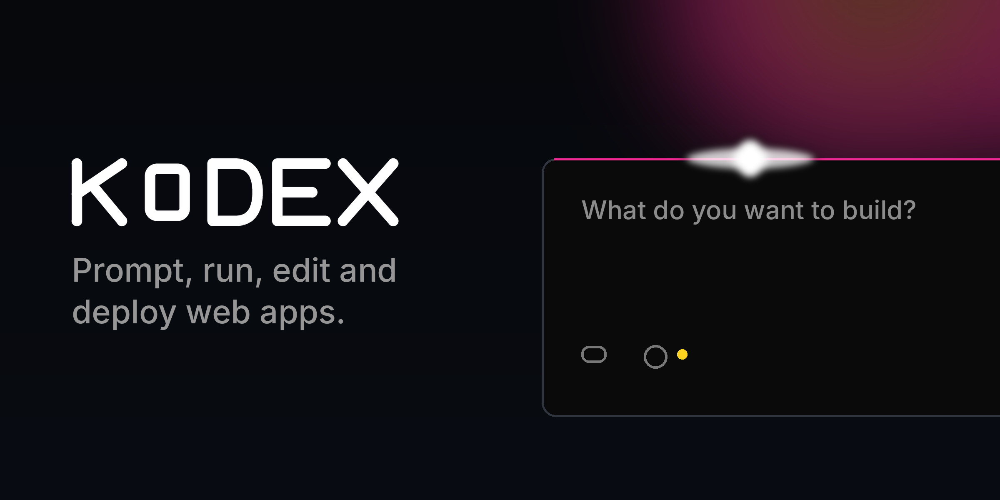

[](#)

> Welcome to the **KODEX** open-source codebase by **Codex.SBS**! This repo contains the core components for building **AI-powered software development tools** that run in the browser, powered by the **WebContainer API** from StackBlitz.

### Why Build with KODEX + WebContainer API

By building with the KODEX codebase and the WebContainer API you can create browser-based applications that let users **prompt, run, edit, and deploy** full-stack web apps directly in the browser, without the need for virtual machines. With WebContainer API, you can build apps that give AI direct access and full control over a **Node.js server**, **filesystem**, **package manager** and **dev terminal** inside your users browser tab. This powerful combination allows you to create a new class of development tools that support all major JavaScript libraries and Node packages right out of the box, all without remote environments or local installs.

### Attribution and Upstream Project

This codebase is derived from the open-source Bolt.new project by StackBlitz, Inc. (MIT License, copyright (c) 2024 StackBlitz, Inc.). The original copyright and license notice is retained in [LICENSE](./LICENSE). KODEX by Codex.SBS is a separate product and is not affiliated with StackBlitz, Inc. The upstream project is available at [github.com/stackblitz/bolt.new](https://github.com/stackblitz/bolt.new).

# Get Started Building with KODEX

KODEX combines the capabilities of AI with sandboxed development environments to create a collaborative experience where code can be developed by the assistant and the programmer together. KODEX combines [WebContainer API](https://webcontainers.io/api) with [Claude Sonnet 3.5](https://www.anthropic.com/news/claude-3-5-sonnet) using [Remix](https://remix.run/) and the [AI SDK](https://sdk.vercel.ai/).

### WebContainer API

KODEX uses [WebContainers](https://webcontainers.io/) to run generated code in the browser. WebContainers provide KODEX with a full-stack sandbox environment using [WebContainer API](https://webcontainers.io/api). WebContainers run full-stack applications directly in the browser without the cost and security concerns of cloud hosted AI agents. WebContainers are interactive and editable, and enable KODEX's AI to run code and understand any changes from the user.

The [WebContainer API](https://webcontainers.io) is free for personal and open source usage. If you're building an application for commercial usage, you can learn more about [WebContainer API commercial usage pricing here](https://stackblitz.com/pricing#webcontainer-api).

### Remix App

KODEX is built with [Remix](https://remix.run/) and
deployed using [CloudFlare Pages](https://pages.cloudflare.com/) and
[CloudFlare Workers](https://workers.cloudflare.com/).

### AI SDK Integration

KODEX uses the [AI SDK](https://github.com/vercel/ai) to integrate with AI
models. At this time, KODEX supports using Anthropic's Claude Sonnet 3.5.
You can get an API key from the [Anthropic API Console](https://console.anthropic.com/) to use with KODEX.
The integration lives in `app/lib/.server/llm`.

## Prerequisites

Before you begin, ensure you have the following installed:

- Node.js (v20.15.1)
- pnpm (v9.4.0)

## Setup

1. Clone your copy of the repository (if you haven't already):

```bash
git clone <your-repository-url>
```

2. Install dependencies:

```bash
pnpm install
```

3. Create a `.env.local` file in the root directory and add your Anthropic API key:

```
ANTHROPIC_API_KEY=XXX
```

Optionally, you can set the debug level:

```
VITE_LOG_LEVEL=debug
```

**Important**: Never commit your `.env.local` file to version control. It's already included in .gitignore.

## Available Scripts

- `pnpm run dev`: Starts the development server.
- `pnpm run build`: Builds the project.
- `pnpm run start`: Runs the built application locally using Wrangler Pages. This script uses `bindings.sh` to set up necessary bindings so you don't have to duplicate environment variables.
- `pnpm run preview`: Builds the project and then starts it locally, useful for testing the production build. Note, HTTP streaming currently doesn't work as expected with `wrangler pages dev`.
- `pnpm test`: Runs the test suite using Vitest.
- `pnpm run typecheck`: Runs TypeScript type checking.
- `pnpm run typegen`: Generates TypeScript types using Wrangler.
- `pnpm run deploy`: Builds the project and deploys it to Cloudflare Pages.

## Development

To start the development server:

```bash
pnpm run dev
```

This will start the Remix Vite development server.

## Testing

Run the test suite with:

```bash
pnpm test
```

## Deployment

To deploy the application to Cloudflare Pages:

```bash
pnpm run deploy
```

Make sure you have the necessary permissions and Wrangler is correctly configured for your Cloudflare account. The Cloudflare Pages project name is set in `wrangler.toml`.
