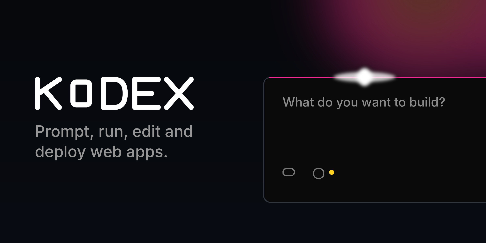

# kodex.sbs: AI-Powered Full-Stack Web Development in the Browser

kodex.sbs is an AI-powered web development agent that lets you prompt, run, edit, and deploy full-stack applications directly from your browser—no local setup required. If you want to build your own AI-powered web dev agent from this codebase, [click here to get started!](./CONTRIBUTING.md)

## What Makes kodex.sbs Different

Claude, v0, etc are incredible- but you can't install packages, run backends or edit code. That's where kodex.sbs stands out:

- **Full-Stack in the Browser**: kodex.sbs integrates cutting-edge AI models with an in-browser development environment powered by **WebContainers**. This allows you to:
  - Install and run npm tools and libraries (like Vite, Next.js, and more)
  - Run Node.js servers
  - Interact with third-party APIs
  - Deploy to production from chat
  - Share your work via a URL

- **AI with Environment Control**: Unlike traditional dev environments where the AI can only assist in code generation, kodex.sbs gives AI models **complete control** over the entire environment including the filesystem, node server, package manager, terminal, and browser console. This empowers AI agents to handle the entire app lifecycle—from creation to deployment.

Whether you're an experienced developer, a PM or designer, kodex.sbs allows you to build production-grade full-stack applications with ease.

For developers interested in building their own AI-powered development tools with WebContainers, check out the open-source codebase in this repo: [https://github.com/sagarkunal9827-wq/kodex.git](https://github.com/sagarkunal9827-wq/kodex.git)

## Tips and Tricks

Here are some tips to get the most out of kodex.sbs:

- **Be specific about your stack**: If you want to use specific frameworks or libraries (like Astro, Tailwind, ShadCN, or any other popular JavaScript framework), mention them in your initial prompt to ensure kodex.sbs scaffolds the project accordingly.

- **Use the enhance prompt icon**: Before sending your prompt, try clicking the 'enhance' icon to have the AI model help you refine your prompt, then edit the results before submitting.

- **Scaffold the basics first, then add features**: Make sure the basic structure of your application is in place before diving into more advanced functionality. This helps kodex.sbs understand the foundation of your project and ensure everything is wired up right before building out more advanced functionality.

- **Batch simple instructions**: Save time by combining simple instructions into one message. For example, you can ask kodex.sbs to change the color scheme, add mobile responsiveness, and restart the dev server, all in one go saving you time and reducing API credit consumption significantly.

## Repository & License

Official repository for **kodex.sbs**: [https://github.com/sagarkunal9827-wq/kodex.git](https://github.com/sagarkunal9827-wq/kodex.git)

Released under the MIT License. See the [LICENSE](./LICENSE) file for details.
